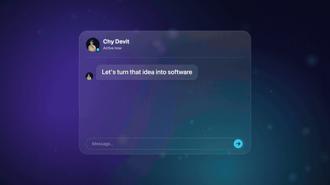
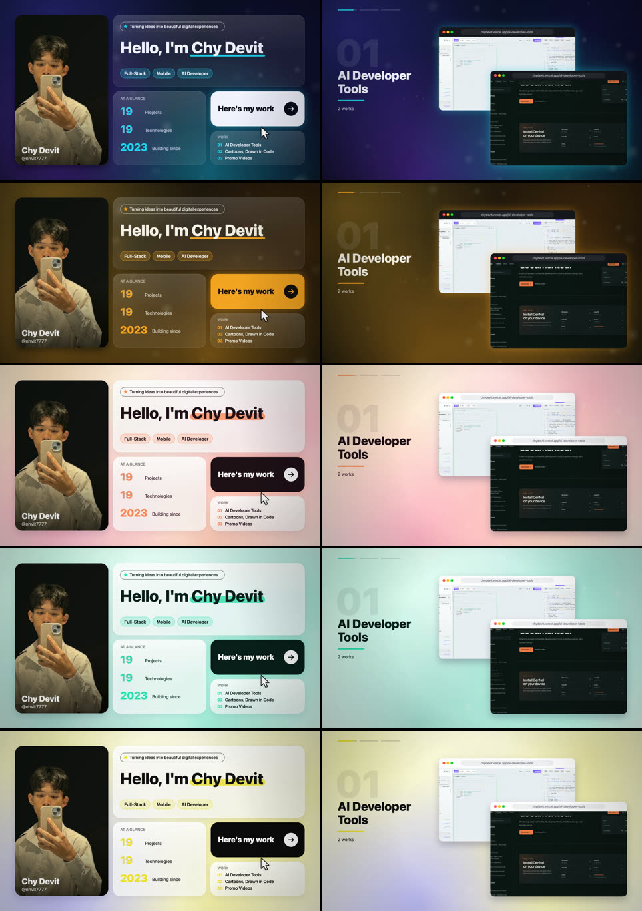
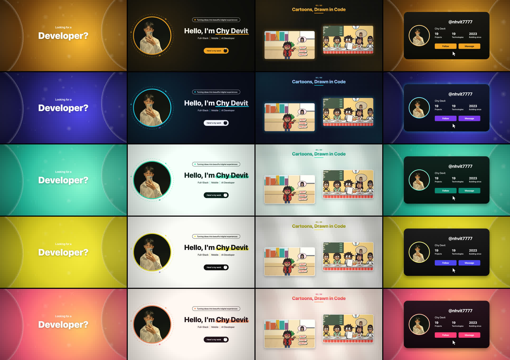
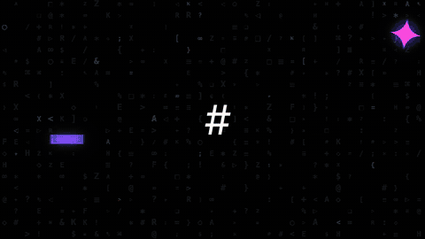
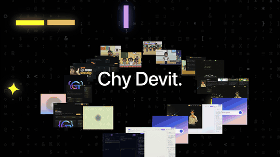
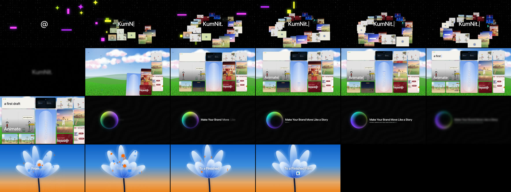
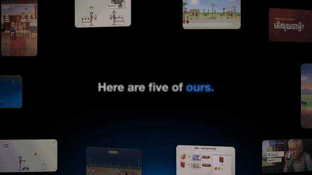
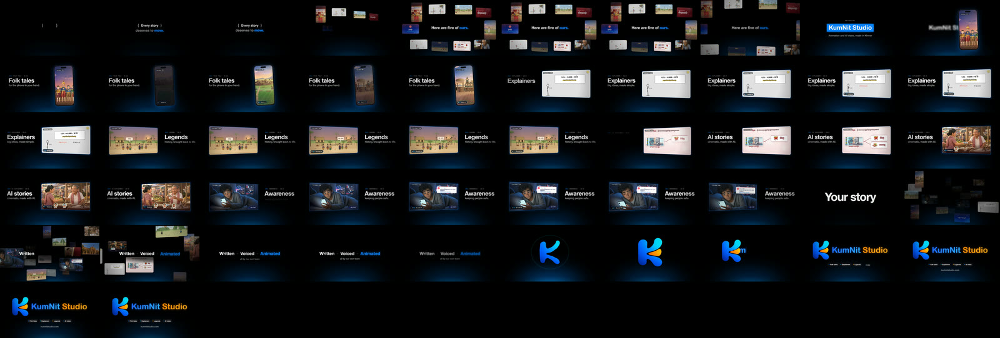

# Skill-create-videos: logo and video skills for Claude Code

Five [Claude Code](https://claude.com/claude-code) skills that turn your logo, screenshots and clips into finished videos, ready to post. Everything is drawn in code and rendered on your own computer. There is no stock footage, no template service and no AI video generator. English or Khmer.

| | Type this | You get |
|---|---|---|
| 🎬 video | **`/portfolio-reel`** | a ~30 s **creator / developer intro reel** in 2 UIs and 5 colour styles: hook question, profile, your work playing in cards or device mockups, a profile card with a Follow click |
| 🎬 video | **`/saas-promo`** | an ~11 s kinetic **SaaS / product promo** of your screenshots, or a ~50 s version with one chapter per project, **cut on the beat of your song** |
| 🎬 video | **`/brand-promo`** | a ~50 s **studio showreel** of your videos, with an original score and narration |
| 🎬 video | **`/brand-loop`** | a seamless 4K 60 fps **looping background** of glossy liquid blobs in your colours |
| ✨ logo | **`/generate-logo`** | 5-second animated **logo reveals** in 5 styles, with sound and transparent versions |

## Demos

### `/portfolio-reel`: creator / developer intro reel

**App UI** (`"ui": "app"`): a search bar types the hook, the result opens a bento dashboard, the work slides past in browser and phone mockups, the closing lines arrive as chat messages, and the profile card flips to a QR code.




▶ [Watch the whole app-UI reel with sound (35 s MP4)](docs/videos/portfolio-reel-app.mp4)

The same reel in all 5 styles (`"style"`: midnight, amber, sunset, mint, mustard):



**Classic UI** (the default, after the template): a hook question on a gradient, a white profile page, scrolling work sections and a black profile card.


▶ [Watch the classic reel in the amber style (30 s MP4)](docs/videos/portfolio-reel-classic.mp4)



### `/saas-promo`: SaaS / product promo



▶ [Watch the 11 s promo with sound (MP4)](docs/videos/saas-promo.mp4)

**50 s long cut** (`"chapters"`): one chapter per project, every cut on the beat of your song. The GIF has no sound; the demo was cut to a commercial song, which isn't included here.





### `/brand-promo`: studio showreel




### `/brand-loop`: seamless liquid background


### `/generate-logo`: logo reveals
| liquid style | a bespoke style set made for one logo |
|---|---|
|  |  |

## Install

This repo is private, so your GitHub account needs access (sign in with `gh auth login` first).

### Option A: as a Claude Code plugin (recommended)

In Claude Code, run:

```
/plugin marketplace add chydevit/Skill-create-videos
/plugin install video-skills@chydevit-skills
/plugin install logo-skills@chydevit-skills
```

Start a new session. The skills then appear as `/video-skills:portfolio-reel`, `/video-skills:saas-promo`, `/video-skills:brand-promo`, `/video-skills:brand-loop` and `/logo-skills:generate-logo`. To get updates later, run `/plugin marketplace update chydevit-skills`.

### Option B: clone and link

```bash
gh repo clone chydevit/Skill-create-videos
cd Skill-create-videos
./install.sh
```

`install.sh` links every skill into `~/.claude/skills/`, so the commands are the short ones (`/portfolio-reel`, `/saas-promo`, …). Because they are links, `git pull` updates them in place. Use `./install.sh --copy` to copy instead, or `./install.sh --remove` to uninstall.

Use one option, not both, or each skill shows up twice.

### Check your tools

```bash
./doctor.sh
```

```
Needed by every skill:
  ✓ ffmpeg with libx264
  ✓ Node v22+
  ✓ Chrome / Chromium
  ✓ Python with numpy + scipy
Optional:
  ✓ qrencode (QR code on the portfolio-reel app card)
  ✓ Blender (brand-loop)
  ✓ VoxCPM2 narration (brand-promo)
```

Anything marked ✗ prints the command that installs it.

## Use: just ask

```
/portfolio-reel make an intro reel with me.jpg and my three best clips
/portfolio-reel the same reel with the app UI in the amber style
/portfolio-reel the same reel in Khmer, ending on my TikTok profile card

/saas-promo make a promo from the screenshots in shots/ with the headline "Ship Your Product Faster"
/saas-promo a 50 second version with a chapter for each project, set to song.mp3

/brand-promo make a showreel from ex1.mp4 to ex5.mp4 with my logo animation
/brand-loop make a 10 second looping background in the colours of logo.png
/generate-logo animate logo.png
```

You don't have to type the slash: asking in plain words ("make an intro reel about me", "animate this logo") picks the right skill. Claude looks at your files first, shows you a preview sheet, then renders the full video.

## What each skill does

### `/portfolio-reel`
- **What you give it:** one `promo.json` with your photo, a hook question, a greeting, your roles, 1-4 work sections (each 1-3 clips or pictures), two closing lines and your profile card (handle, name, real stats).
- **Two UIs:** `classic` follows the template; `app` is a search bar, bento dashboard, device carousel, chat and QR card.
- **Five colour styles and ten effects:** bokeh, light sweeps, a highlighter under your name, an orbiting avatar ring, motion blur, section numbers, card glare, a tag ticker, confetti and film grain.
- **Sound:** a synthesised lo-fi beat or your own track, a sound on every move, a −14 LUFS mix.
- **Docs:** [SKILL.md](plugins/video-skills/skills/portfolio-reel/SKILL.md), [all config keys](plugins/video-skills/skills/portfolio-reel/references/config.md).

### `/saas-promo`
- **The scenes:** glyph flashes, your word typing inside a 3D swirl of your cards, a bento wall on a painted meadow, a glowing orb headline, and a "From … / To …" finale.
- **Long cut:** add `chapters` for ~50 s. Give it a song and the skill measures its tempo and drop, so the first cut lands on the drop and every cut on a bar.
- **Docs:** [SKILL.md](plugins/video-skills/skills/saas-promo/SKILL.md), [all config keys](plugins/video-skills/skills/saas-promo/references/config.md).

### `/brand-promo`
- **The video:** a typed intro, a ring of 3D cards, a glitchy title drop, a spotlight for each work (playing its own sound), "Your story… next.", a 3D rush of clips and the liquid logo reveal.
- **Sound:** a synthesised score and VoxCPM2 narration.
- **Docs:** [SKILL.md](plugins/video-skills/skills/brand-promo/SKILL.md), [all config keys](plugins/video-skills/skills/brand-promo/references/config.md).

### `/brand-loop`
- **The video:** metaball blobs in two colour families that merge like mercury, rendered in Blender EEVEE at 4K60. Every motion is periodic, so the last frame flows into the first. The colours can come straight from your logo.
- **Docs:** [SKILL.md](plugins/video-skills/skills/brand-loop/SKILL.md).

### `/generate-logo`
- **Styles:** liquid, neon, bounce, lens and rise, each ending on your logo's own pixels.
- **Files:** for each style, a 1080p60 MP4 with sound, a transparent WebM (and ProRes 4444) and a keyframe sheet.
- **Sizes:** square and vertical versions too.
- **Docs:** [SKILL.md](plugins/logo-skills/skills/generate-logo/SKILL.md).

## Run the scripts yourself (without Claude)

```bash
V=plugins/video-skills/skills; G=plugins/logo-skills/skills
$V/portfolio-reel/scripts/promo.sh my-reel/promo.json --preview   # about 13 stills
$V/portfolio-reel/scripts/promo.sh my-reel/promo.json --jobs 4    # the full reel, about 3 min
$V/saas-promo/scripts/promo.sh my-saas/promo.json --preview       # 12 stills in ~10 s
$V/saas-promo/scripts/promo.sh my-saas/promo.json                 # the full video
$V/brand-promo/scripts/promo.sh my-promo/promo.json               # the full showreel, ~10 min
$V/brand-loop/scripts/loop.sh --name acme --logo logo.png --res 1920x1080
$G/generate-logo/scripts/animate.sh logo.png --styles liquid,neon --size square
```

## Requirements

| Skill | Needs |
|---|---|
| all | macOS or Linux, [ffmpeg](https://ffmpeg.org) (libx264; libx265 for brand-loop), Node 22+, Google Chrome or Chromium (`CHROME_PATH` if it is elsewhere) |
| `/portfolio-reel`, `/saas-promo`, `/brand-promo` | Python with `numpy` and `scipy` (`PROMO_PY`) |
| `/portfolio-reel` app UI | optional: [`qrencode`](https://fukuchi.org/works/qrencode/) for the QR code (`brew install qrencode`) |
| `/brand-promo` | optional: [VoxCPM2](https://github.com/OpenBMB/VoxCPM) for narration (`pip install voxcpm soundfile`, `VOX_PY`) |
| `/brand-loop` | [Blender](https://www.blender.org) 4.2 or newer with EEVEE on a GPU |

## Repo layout

```
.claude-plugin/marketplace.json      the plugin marketplace ("chydevit-skills")
plugins/video-skills/                plugin: portfolio-reel, saas-promo, brand-promo, brand-loop
plugins/logo-skills/                 plugin: generate-logo
docs/                                demo GIFs, contact sheets and short MP4s
install.sh, doctor.sh                link the skills / check the tools
```

The Khmer fonts Kantumruy Pro and Koulen are included under the SIL Open Font License (in each skill's `fonts/` folder).
