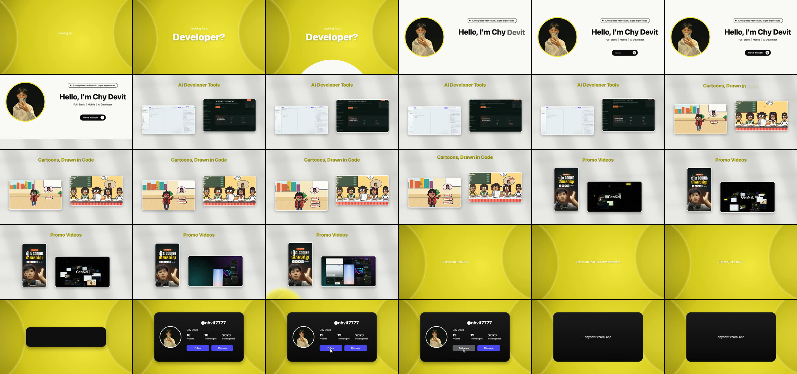

# logo-gp: brand motion skills for Claude Code

Five [Claude Code](https://claude.com/claude-code) skills that turn a brand's logo and its own work into finished videos, ready to post. Everything is drawn in code and rendered on your own machine. There is no stock footage, no template service and no AI video generator.

| Type this | You get |
|---|---|
| **`/generate-logo`** | 5-second animated **logo reveals** in 5 styles from any logo image, with sound and transparent versions |
| **`/brand-promo`** | a ~50-second dark, kinetic **studio showreel** of your work, with an original score, narration (English or Khmer) and each work's own sound |
| **`/brand-loop`** | a seamless 4K 60 fps **looping background** of glossy liquid blobs in your brand colours |
| **`/saas-promo`** | an ~11-second kinetic **SaaS / product promo** of your screenshots (a typed word in a 3D card swirl, a bento wall on a meadow, an orb headline and a "From … / To …" finale), or a ~50-second version with one chapter per project, cut on the beat of your own song |
| **`/portfolio-reel`** | a ~30-second **creator / developer intro reel**: a hook question, an "Hello, I'm …" profile hero, work sections playing your clips, and a social profile card that gets a Follow click and flips |

## Examples

### `/generate-logo`: logo reveals
| liquid style (the KumNit K) | a bespoke style set made for one logo (PharmKulen) |
|---|---|
|  |  |

### `/brand-promo`: studio showreel


### `/brand-loop`: seamless liquid background


### `/saas-promo`: SaaS / product promo


### `/portfolio-reel`: creator intro reel




## Install

This repo is private, so your GitHub account needs access.

```bash
gh repo clone chydevit/logo-gp        # or: git clone https://github.com/chydevit/logo-gp.git
cd logo-gp
./install.sh
```

`install.sh` links every skill folder into `~/.claude/skills/`. **Start a new Claude Code session**, type `/`, and `generate-logo`, `brand-promo`, `brand-loop`, `saas-promo` and `portfolio-reel` appear in the list. Because they're links, `git pull` updates them in place.

| Command | What it does |
|---|---|
| `./install.sh` | install (link) |
| `./install.sh --copy` | install a copy instead of links |
| `./install.sh --remove` | uninstall |

## Use: just type `/` and the skill name

```
/generate-logo animate logo.png
/generate-logo make neon and lens versions of brand/logo.png, square for Instagram
/generate-logo animate mark.png and add the name "Pharm|Kulen" next to it

/brand-promo make a showreel from ex1.mp4 to ex5.mp4 with my logo animation
/brand-promo the same showreel in Khmer, with a Khmer narrator

/brand-loop make a 10 second looping background in the colours of logo.png
/brand-loop 1080p loop, teal and coral, for our website hero

/saas-promo make a promo from the screenshots in shots/ with the headline "Ship Your Product Faster"
/saas-promo the same promo in Khmer, with my logo at the end
/saas-promo a 50 second version with a chapter for each project, set to song.mp3

/portfolio-reel make an intro reel with me.jpg and my three best clips
/portfolio-reel the same reel in Khmer, ending on my TikTok profile card
```

You don't have to type the slash. Asking in plain words ("make a showreel of our work", "animate this logo", "a looping background in our colours") picks the right skill too. Claude looks at your files first, shows you a quick preview, then renders the full video.

## What each skill does

### `/generate-logo`
- **Styles:** liquid, neon, bounce, lens and rise. Every one ends on your logo file's own pixels.
- **Files:** each style comes as a 1080p60 MP4 with synthesised sound, a transparent WebM (and ProRes 4444 with `--prores`) and a keyframe sheet.
- **Extras:** square and vertical sizes, a two-tone wordmark (`--text "Pharm|Kulen"`), and bespoke styles for a particular logo.
- **Docs:** [generate-logo/SKILL.md](generate-logo/SKILL.md).

### `/brand-promo`
One `promo.json` file describes the whole video:
- 3-5 of your videos (vertical ones play on a phone).
- Your logo animation (made with `/generate-logo` liquid).
- Your name, colours, texts and narration lines.

The video runs in this order:
1. A typed intro, then a ring of 3D cards.
2. A glitchy title drop.
3. A spotlight for each work, playing its own sound with live level bars.
4. "Your story… next.", then a 3D rush of clips.
5. The liquid logo reveal, with chips and your website.

The score is synthesised, every cut sits on its beat, and the mix is set to −14 LUFS. Timings are measured from the narration automatically.
- **Docs:** [brand-promo/SKILL.md](brand-promo/SKILL.md) and [all config keys](brand-promo/references/config.md).
- **Example config:** [brand-promo/examples/kumnit-showreel.json](brand-promo/examples/kumnit-showreel.json).

### `/brand-loop`
- **The look:** two colour families of metaball blobs that merge and pinch off like mercury, on a warm off-white studio backdrop with ripple rings, soft shadows and shallow depth of field.
- **Render:** Blender EEVEE at 4K60.
- **Loop:** every motion is periodic, so the last frame flows into the first.
- **Colours:** they can come straight from a logo (`--logo logo.png`).
- **Docs:** [brand-loop/SKILL.md](brand-loop/SKILL.md).

### `/saas-promo`
One `promo.json` file describes the video: 8-20 pictures (screenshots, UI, design work or stills from your videos), a typed word, three short card phrases, a headline with a subline, and a "From … / To …" pair. Built-in UI cards fill in when there are fewer pictures.

The video runs in this order:
1. Glyph flashes and purple and lime neon shapes on a dot-matrix field.
2. Your word types in while a 3D ring of your cards orbits it.
3. The cards build a bento wall on a painted meadow, with words typing inside them, and the camera zooms into one card.
4. A glowing gradient orb reveals the headline word by word.
5. A glitch drops into a long-exposure flower with flying symbols, and "From … / To …" closes it, with your logo.

Every scene change has its own sound (typing, whooshes, a riser, impacts, a glitch) over a synthesised ambient bed or your own track, and the mix is set to −14 LUFS. English or Khmer. The full render takes under a minute.

Add `chapters` for a **~50 s long cut**: the four scenes repeat once per chapter (each with its own pictures, words, wall look and orb colours). Give it a song and its tempo and drop are measured, so the first cut lands on the drop and every cut sits on a bar.
- **Docs:** [saas-promo/SKILL.md](saas-promo/SKILL.md) and [all config keys](saas-promo/references/config.md).
- **Example config:** [saas-promo/examples/kumnit-saas.json](saas-promo/examples/kumnit-saas.json).

### `/portfolio-reel`
One `promo.json` describes the reel:
- your photo, the hook question, the greeting, roles, the badge and the button;
- 1-4 work sections, each a title and 1-3 clips or pictures;
- two closing lines and your social profile card (handle, name, real stats).

The video runs in this order:
1. On a mustard-yellow gradient, the hook types in ("Looking for a / **Video editor?**").
2. A white circle wipe opens on your profile hero.
3. The page scrolls through your work: the clips play in rounded cards.
4. A yellow light wipe brings the closing lines.
5. The profile card pops up with counting stats. A cursor clicks Follow, then the card flips to its back.

It comes with a synthesised lo-fi beat or your own track, a sound on every move, and a −14 LUFS mix. English or Khmer.
- **Docs:** [portfolio-reel/SKILL.md](portfolio-reel/SKILL.md) and [all config keys](portfolio-reel/references/config.md).

## Run the scripts yourself (without Claude)

```bash
generate-logo/scripts/animate.sh logo.png --styles liquid,neon --size square
brand-promo/scripts/promo.sh my-promo/promo.json --preview     # 12 stills in ~30 s
brand-promo/scripts/promo.sh my-promo/promo.json               # the full video, ~10 min
brand-loop/scripts/loop.sh --name acme --logo logo.png --preview
brand-loop/scripts/loop.sh --name acme --logo logo.png --res 1920x1080
saas-promo/scripts/promo.sh my-saas/promo.json --preview       # 12 stills in ~10 s
saas-promo/scripts/promo.sh my-saas/promo.json                 # the full video, under a minute
portfolio-reel/scripts/promo.sh my-reel/promo.json --preview  # about 13 stills
portfolio-reel/scripts/promo.sh my-reel/promo.json --jobs 4   # the full reel, about 2 min
```

## Requirements

| Skill | Needs |
|---|---|
| all | macOS or Linux, [ffmpeg](https://ffmpeg.org) (libx264; libx265 for brand-loop), Node 22+, Google Chrome or Chromium (`CHROME_PATH` if it is elsewhere) |
| `/brand-promo` | Python with `numpy` and `scipy` (`PROMO_PY`). For narration, [VoxCPM2](https://github.com/OpenBMB/VoxCPM) (`pip install voxcpm soundfile`, `VOX_PY`). Without it, the promo is made without a narrator |
| `/saas-promo`, `/portfolio-reel` | Python with `numpy` and `scipy` (`PROMO_PY`) |
| `/brand-loop` | [Blender](https://www.blender.org) 4.2 or newer with EEVEE on a GPU (tested on 5.2, Apple Silicon) |

The Khmer fonts Kantumruy Pro and Koulen are included under the SIL Open Font License ([brand-promo/fonts](brand-promo/fonts), [saas-promo/fonts](saas-promo/fonts)).
